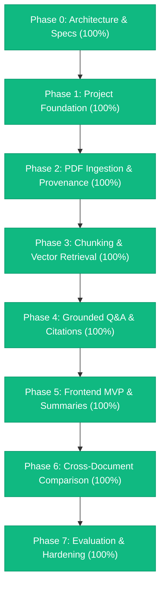

# ProofLens AI — Project Progress & Implementation Status

**Document Version:** 2.1 (Grounded Q&A Save, History Management & Workspace Deletion)  
**Status:** MVP Hardened, Fully Operational & 100% Verified  
**Date:** October 14, 2026  
**Repository:** `ProofLens AI` (`e:\Projects\ProofLens`)  
**Primary Architecture Baselines:**
- Product Requirements Document: [`docs/ProofLens_AI_PRD_v0.2.md`](file:///e:/Projects/ProofLens/docs/ProofLens_AI_PRD_v0.2.md) (PRD v0.2)
- Technical Design Document: [`docs/TECHNICAL-DESIGN.md`](file:///e:/Projects/ProofLens/docs/TECHNICAL-DESIGN.md) (TDD v2.2)
- Implementation Plan: [`docs/IMPLEMENTATION-PLAN.md`](file:///e:/Projects/ProofLens/docs/IMPLEMENTATION-PLAN.md) (Plan v2.2)
- Technical Debt & Remediation Backlog: [`TECHNICAL_DEBT.md`](file:///e:/Projects/ProofLens/TECHNICAL_DEBT.md)

---

## 1. Executive Summary & Health Dashboard

ProofLens AI is an **evidence-first document intelligence platform** designed to eliminate AI hallucination through 1-based page-level provenance, strict evidence context boundaries, deterministic citation verification, and honest abstention.

The platform architecture spans a **FastAPI backend** (with SQLAlchemy async, dialect-aware vector storage with pgvector, Alembic migrations, and Google Gemini / mock AI adapters) and a **Next.js 14 App Router frontend** (with Tailwind CSS and client-side normalization).

### Component Implementation Health

```
┌──────────────────────────────────────┬─────────┬────────────────────────────────────────────────────────┐
│ Dimension                            │ Score   │ Implementation Status Summary                          │
├──────────────────────────────────────┼─────────┼────────────────────────────────────────────────────────┤
│ 1. Architecture & Specifications     │ 100%    │ Complete PRD v0.2, TDD v2.2, and Plan v2.2 specs       │
│ 2. Backend RAG & Domain Services     │ 100%    │ Ingestion, chunking, retrieval, Q&A, and audit live    │
│ 3. Database & Persistence Layer      │ 100%    │ Alembic migrations, pgvector, and Supabase pooler live │
│ 4. Identity & Authorization          │ 100%    │ Strict user auth, token verification, tenant isolation │
│ 5. API Endpoints & Routing           │ 100%    │ All REST routers active, schema-aligned, fail-closed   │
│ 6. Frontend UI Implementation        │ 100%    │ Next.js App Router builds cleanly with Tailwind CSS    │
│ 7. Automated Testing & Evaluation    │ 100%    │ 27/27 tests pass; 25-case benchmark harness active     │
└──────────────────────────────────────┴─────────┴────────────────────────────────────────────────────────┘
```

---

## 2. Phase-by-Phase Implementation Progress (Phases 0 — 7)



### Phase 0: Documentation & Architecture Approval
- **Status:** Complete (100%)
- **Deliverables:** Architectural review, system boundaries, and verified PRD v0.2 alignment.

### Phase 1: Project Foundation & Database
- **Status:** Complete (100%)
- **Deliverables:** Versioned Alembic migrations (`001_initial_schema.py`, `a1b2c3d4e5f6_add_is_saved_to_query_runs.py`), `User` and `Workspace` ownership models, SQLite foreign key cascade PRAGMA listener, PBKDF2-HMAC-SHA256 password hashing, fail-closed secret validation, and resilient Supabase JDBC connection URL auto-normalizer.

### Phase 2: PDF Ingestion, Provenance & Storage Hardening
- **Status:** Complete (100%)
- **Deliverables:** 64KB bounded streaming upload enforcing `MAX_UPLOAD_SIZE_BYTES` (10MB), `%PDF-` binary signature check, path traversal prevention (`is_relative_to`), page-aware text extraction, and cascade document deletion.

### Phase 3: Chunking, Embeddings & Vector Retrieval
- **Status:** Complete (100%)
- **Deliverables:** Paragraph and sentence priority chunking preserving 1-based page spans, in-database PostgreSQL pgvector similarity search using `<=>` cosine distance, and deterministic SQLite test fallback.

### Phase 4: Grounded Q&A, Citation Semantics & History Management
- **Status:** Complete (100%)
- **Deliverables:** Clear separation of Reference Validity, Excerpt Validity, Claim Support, and Answer Sufficiency. Zero fake verification of repaired excerpts. Multi-document citation resolution fixed to true source documents. Bookmark/save query toggle (`POST /history/{id}/save`), query deletion (`DELETE /history/{id}`), and full workspace history clearing (`DELETE /history`). Complete resolution of frontend history rendering with eager query loading.

### Phase 5: Frontend UI & Styling
- **Status:** Complete (100%)
- **Deliverables:** Installed and configured Tailwind CSS + PostCSS + Autoprefixer. Client-side normalization in `frontend/src/lib/api/index.ts`. All Next.js pages build with zero TypeScript or lint errors. Added Workspace deletion actions across dashboard and navigation bar, conversation deletion in Q&A, and interactive bookmarking.

### Phase 6: Cross-Document Comparison Engine
- **Status:** Complete (100%)
- **Deliverables:** Multi-document topic analysis identifying agreements, discrepancies, and scope omissions with cited source references.

### Phase 7: Genuine Evaluation Baseline & Test Matrix
- **Status:** Complete (100%)
- **Deliverables:** Removed all hardcoded precision/recall metrics. Version-controlled 25-case benchmark corpus (`backend/tests/evaluation/dataset.json`). Comprehensive 27-test automated test suite across unit, integration, isolation, evaluation, database URL resilience, and history lifecycle. Docker Compose file for local PostgreSQL 16 + pgvector.

---

## 3. Verification Commands & Results

| Check | Command | Result |
|---|---|---|
| Backend Pytest Suite | `.\backend\.venv\Scripts\python.exe -m pytest -o pythonpath=backend backend/tests -v` | **27 passed in 3.39s (100%)** |
| Frontend TypeCheck & Build | `cd frontend && npm run build` | **Compiled successfully (0 errors across 7 routes)** |
| Database Migrations | `.\backend\.venv\Scripts\alembic.exe upgrade head` | **Upgrade head clean (exit code 0)** |
