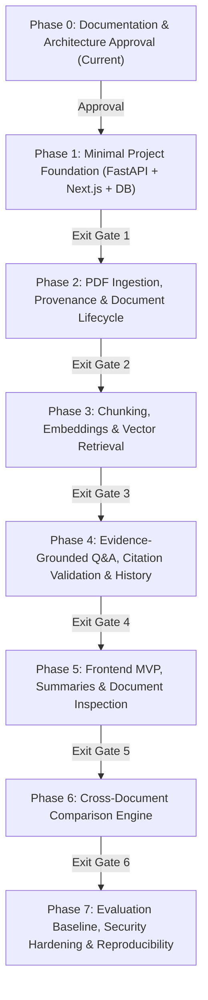

# ProofLens AI — Phased Implementation Plan

**Document Version:** 2.1 (Full-Stack Implementation Complete)  
**Status:** Implemented & Verified — Full-Stack MVP Operational  
**Date:** October 2026  
**Primary Architecture Baseline:** [docs/TECHNICAL-DESIGN.md](file:///e:/Projects/ProofLens/docs/TECHNICAL-DESIGN.md) (TDD v2.0)  
**Product Specification:** [docs/ProofLens_AI_PRD_v0.2.md](file:///e:/Projects/ProofLens/docs/ProofLens_AI_PRD_v0.2.md) (PRD v0.2, dated 12 October 2026 — Verified Source of Truth)  

---

## 1. Overview and Implementation Principles

This implementation plan translates the system architecture defined in `docs/TECHNICAL-DESIGN.md` into eight sequential, independently verifiable phases (Phase 0 through Phase 7).

### 1.1 Non-Negotiable Implementation Controls
Any future engineer or automated agent executing this plan must adhere strictly to the following rules:
1. **No Out-of-Phase Code Generation:** Never implement components belonging to future phases. Work strictly within the boundaries of the currently approved phase.
2. **Mandatory Test Verification:** Every phase includes automated test commands. Never declare an implementation task or phase complete without executing the tests and inspecting their terminal output.
3. **Free-Tier Integrity:** Never add paid cloud dependencies, switch providers silently, or enable unmetered retry loops. All AI calls must remain within verified free-tier quotas.
4. **Preserve Provenance:** Text extraction, chunking, and database persistence must preserve 1-based source page provenance at every step.
5. **Stop at Exit Gates:** Every phase ends with an explicit **Exit Gate & Review Decision**. You must stop and obtain user/owner approval before starting the next phase.

### 1.2 PRD Requirements & Acceptance Criteria Phase Mapping
The following table maps every PRD Functional Requirement (FR-01 to FR-17), Non-Functional Requirement (NFR), and MVP Acceptance Criterion (AC-01 to AC-18) to its assigned phase and testable exit gate:

| Requirement / Acceptance Criterion | PRD Reference | Target Phase | Testable Exit Gate / Validation Mechanism |
| :--- | :--- | :--- | :--- |
| **FR-01: Workspace & document library** | PRD §7 | Phase 1 (Schema) & Phase 2 (API) & Phase 5 (UI) | Cross-workspace isolation tests & library UI display |
| **FR-02: PDF upload and validation** | PRD §7 | Phase 2 | Rejection of malformed/oversized files with HTTP 400/413/422 |
| **FR-03: Extraction and provenance** | PRD §7 | Phase 2 | Extraction tests asserting 1-based page index preservation |
| **FR-04: Chunking and embeddings** | PRD §7 | Phase 3 | Token boundary tests & 768-dim `gemini-embedding-2` vector creation |
| **FR-05: Vector storage & retrieval** | PRD §7 | Phase 3 | pgvector similarity tests with workspace scoping |
| **FR-06: Evidence-grounded Q&A** | PRD §7 | Phase 4 | Mocked LLM integration tests verifying strict context grounding |
| **FR-07: Citation contract & validation** | PRD §7 | Phase 4 | Server-side validation rejecting invalid excerpt/page tokens |
| **FR-08: Abstention & conflicting evidence** | PRD §7 | Phase 4 | Out-of-corpus query test verifying `insufficient_evidence` response |
| **FR-09: Document summaries & questions** | PRD §7 | Phase 5 | DB caching and quota exhaustion fallback verification |
| **FR-10: Cross-document comparison** | PRD §7 | Phase 6 | Multi-document claim matrix asserting agreement/conflict flags |
| **FR-11: Document lifecycle, retry, delete** | PRD §7 | Phase 2 & Phase 3 & Phase 7 | Idempotent retry tests and zero orphaned records cascade check |
| **FR-12: Saved history** | PRD §7 | Phase 4 (DB) & Phase 5 (UI) | Query run audit inspection and frontend history drawer replay |
| **FR-13: Search and filters** | PRD §7 | Phase 2 (Library) & Phase 3 (Vector) | Document library filter tests & scoped vector search |
| **FR-14: Usage and quota controls** | PRD §7 | Phase 1 (Config) & Phase 4 (Guard) & Phase 5 (UI) | HTTP 429 quota exhaustion mapping; assertion of zero paid fallback |
| **FR-15: Evaluation** | PRD §7 | Phase 7 (Harness) & Phase 5 (UI) | Automated 25-case evaluation report meeting baseline thresholds |
| **FR-16: Observability & error handling** | PRD §7 | Phase 1 & Phase 7 | Structured JSON log checks verifying zero secret/PII leaks |
| **FR-17: User interface & accessibility** | PRD §7 | Phase 5 & Phase 6 | Keyboard navigation, contrast audit, and responsive layout tests |
| **NFR: Reliability, Performance, Maintainability** | PRD §12 | All Phases | Modular adapter tests, batch limits, latency logging |
| **AC-01..18: MVP Acceptance Criteria** | PRD §14 | Phase 7 | Complete end-to-end acceptance test battery execution |
| **Deferred: OCR, Hybrid Search, Cloud Deploy** | PRD §4.2, §4.3 | Out of Scope / Post-MVP | Documented as non-goals; excluded from all MVP phases |

---

## 2. Phase-by-Phase Roadmap

---

### Phase 0: Documentation and Architecture Approval

* **Objective:** Review and approve the Technical Design Document (`docs/TECHNICAL-DESIGN.md`) and this Phased Implementation Plan (`docs/IMPLEMENTATION-PLAN.md`). Resolve foundational questions regarding provider selection, deployment targets, and user scope.
* **Prerequisites:** Clean project workspace; PRD v0.2 verified.
* **Scope:**
  * Architectural documentation and roadmap review.
  * Formal owner approval of technical decisions (TDR-01 through TDR-10).
* **Explicit Exclusions:**
  * **No application code**, configuration files, package manifests, or database migrations are created in Phase 0.
* **Tasks:**
  1. Verify completeness of `docs/TECHNICAL-DESIGN.md` against PRD v0.2 requirements.
  2. Verify consistency of `docs/IMPLEMENTATION-PLAN.md` with technical architecture.
  3. Validate external provider assumptions:
     * Note verified shutdown of `text-embedding-004` (Jan 2026) and `gemini-2.0-flash`.
     * Note verified active models: `gemini-embedding-2` (768-dim) and `gemini-2.5-flash`.
     * Note data policy: Google Standard Free Tier inputs may be used to improve Google products.
* **Exit Gate & Review Decision:**
  * Owner reviews both documents and issues formal approval to proceed to Phase 1.

---

### Phase 1: Minimal Project Foundation

* **Objective:** Establish the foundational directory structures, environment configurations, PostgreSQL connection with `pgvector`, database migration tooling (Alembic), core health check APIs, and basic test runners for both backend and frontend.
* **Prerequisites:** Completion and sign-off of Phase 0.
* **Scope:**
  * FastAPI application skeleton with health and readiness endpoints (`/api/v1/health`, `/api/v1/ready`).
  * Pydantic `BaseSettings` configuration loader (`app/core/config.py`) with zero-paid-fallback policy.
  * Structured JSON logger with correlation ID middleware (`app/core/logging.py`).
  * In-memory usage and rate-limit guard (`app/core/usage.py`).
  * SQLAlchemy async database engine and initial Alembic setup.
  * Next.js 14 App Router project skeleton with TypeScript.
  * Basic Pytest test harness and integration test verification for database connectivity.
* **Explicit Exclusions:**
  * No PDF file handling, document extraction, embeddings, or LLM generation.
* **Expected Files & Modules to Create:**
  * `backend/pyproject.toml`, `backend/requirements.txt`, `backend/requirements-dev.txt`
  * `backend/app/main.py`, `backend/app/core/config.py`, `backend/app/core/database.py`, `backend/app/core/errors.py`, `backend/app/core/logging.py`, `backend/app/core/usage.py`
  * `backend/app/api/v1/router.py`, `backend/app/api/deps.py`
  * `backend/alembic.ini`, `backend/alembic/env.py`, `backend/alembic/versions/001_initial_schema.py`
  * `backend/tests/conftest.py`, `backend/tests/integration/test_health.py`
  * `frontend/package.json`, `frontend/tsconfig.json`, `frontend/src/app/layout.tsx`, `frontend/src/app/page.tsx`
* **Implementation Tasks:**
  1. Initialize Python backend environment, install locked dependencies (`fastapi`, `uvicorn`, `sqlalchemy`, `asyncpg`, `pgvector`, `pydantic-settings`, `alembic`, `pytest`, `httpx`).
  2. Implement `app/core/config.py` with typed environment variables, model identifiers, and secret masking.
  3. Set up `app/core/database.py` with async SQLAlchemy connection pool.
  4. Write Alembic migration `001_initial_schema.py` creating the `vector` extension and the `workspaces` table.
  5. Implement `/api/v1/health` and `/api/v1/ready` endpoints verifying database ping.
  6. Initialize Next.js project skeleton with TypeScript and basic layout.
* **Testing & Validation Commands:**
  * `cd backend && pytest tests/integration/test_health.py` (Must pass with HTTP 200).
  * `cd backend && alembic upgrade head` (Must execute migrations without error).
* **Acceptance Criteria:**
  * Backend starts cleanly on `localhost:8000` and returns `{"status": "ready", "database": "connected"}` on `/api/v1/ready`.
  * Alembic migration cleanly creates `workspaces` table and confirms `pgvector` extension in PostgreSQL.
* **Exit Gate & Review Decision:**
  * Verify automated health check tests pass before advancing to Phase 2.

---

### Phase 2: PDF Ingestion, Provenance & Document Lifecycle

* **Objective:** Implement PDF upload validation, local file storage abstraction, page-by-page text extraction, 1-based page provenance tracking, unusable/scanned document detection, document library filtering, idempotent retries, and cascade deletion.
* **Prerequisites:** Phase 1 complete and verified.
* **Scope:**
  * Workspace management and document library endpoints.
  * Multipart upload endpoint with MIME and size verification ($\le 15\text{MB}$).
  * Local filesystem storage service (`./data/storage/workspaces/{id}/...`).
  * Text extraction engine using `pypdf` with page provenance recording.
  * Detection and rejection of scanned/empty PDFs with actionable error messages.
  * Ingestion retry endpoint (`POST .../retry`) and cascade deletion (`DELETE .../documents/{id}`).
  * Document library search and status filtering (`GET .../documents?q=...&status=...`).
* **Explicit Exclusions:**
  * Vector chunking and embedding generation (handled in Phase 3).
* **Expected Files & Modules to Create:**
  * `backend/app/models/workspace.py`, `backend/app/models/document.py`
  * `backend/app/schemas/workspace.py`, `backend/app/schemas/document.py`
  * `backend/app/services/storage_service.py`
  * `backend/app/services/pdf_service.py`
  * `backend/app/services/ingestion_service.py`
  * `backend/app/api/v1/workspaces.py`, `backend/app/api/v1/documents.py`
  * `backend/tests/unit/test_pdf_validation.py`, `backend/tests/integration/test_api_documents.py`
* **Implementation Tasks:**
  1. Add Alembic migration for `documents` table with foreign key to `workspaces`.
  2. Implement `StorageService` to safely write uploaded files to `./data/storage/workspaces/{id}/`.
  3. Implement `PDFService.extract_pages(file_path)` extracting text per page and asserting 1-based page numbering.
  4. Implement `PDFService.validate_pdf(file_bytes)` checking magic bytes, encryption, and empty/scanned heuristics.
  5. Implement `IngestionService.process_document(document_id)` coordinating validation, extraction, status transitions (`processing`, `indexed`, `failed`).
  6. Implement endpoints:
     * `POST /api/v1/workspaces`
     * `GET /api/v1/workspaces`
     * `POST /api/v1/workspaces/{id}/documents/upload`
     * `GET /api/v1/workspaces/{id}/documents` (with `q` and `status` query filters)
     * `GET /api/v1/workspaces/{id}/documents/{doc_id}/status`
     * `POST /api/v1/workspaces/{id}/documents/{doc_id}/retry`
     * `DELETE /api/v1/workspaces/{id}/documents/{doc_id}`
* **Testing & Validation Commands:**
  * `cd backend && pytest tests/unit/test_pdf_validation.py`
  * `cd backend && pytest tests/integration/test_api_documents.py`
* **Acceptance Criteria:**
  * Valid text PDF uploads return HTTP 201 with accurate `total_pages` and status `indexed`.
  * Scanned/image-only PDFs are rejected with HTTP 422 and an explicit diagnostic error message.
  * Ingestion failures can be retried via `POST .../retry` cleanly.
  * Document deletion removes the database record and deletes the physical PDF from disk.
* **Exit Gate & Review Decision:**
  * Demonstrate successful text extraction preserving page counts across 3 sample PDFs before moving to Phase 3.

---

### Phase 3: Chunking, Embeddings, and Vector Retrieval

* **Objective:** Implement paragraph- and page-aware text chunking, integrate the verified embedding provider adapter (`gemini-embedding-2`, 768 dimensions), persist vectors in PostgreSQL via `pgvector`, and implement workspace-scoped semantic similarity retrieval.
* **Prerequisites:** Phase 2 complete and verified.
* **Scope:**
  * `PageAwareChunker` breaking extracted page text into bounded chunks with overlap while preserving 1-based page provenance.
  * `EmbeddingAdapter` interface and Google Gemini embedding implementation using `gemini-embedding-2` with batch processing (16 chunks/call) and 768 dimensions.
  * Offline `MockEmbeddingAdapter` for deterministic CI tests.
  * `document_chunks` table with `vector(768)` column and cosine distance IVFFlat/HNSW index.
  * Retrieval service querying top-$k$ chunks with workspace and document ID filters.
  * Idempotent re-indexing logic ensuring zero duplicate active chunks.
* **Explicit Exclusions:**
  * LLM answer generation and citation parsing (handled in Phase 4).
* **Expected Files & Modules to Create:**
  * `backend/app/models/chunk.py`
  * `backend/app/services/chunking_service.py`
  * `backend/app/adapters/base.py`, `backend/app/adapters/gemini_embedding.py`, `backend/app/adapters/mock_adapter.py`
  * `backend/app/services/retrieval_service.py`
  * `backend/alembic/versions/002_chunks_pgvector.py`
  * `backend/tests/unit/test_chunking.py`, `backend/tests/integration/test_vector_search.py`
* **Implementation Tasks:**
  1. Add Alembic migration creating `document_chunks` with `embedding vector(768)` and an IVFFlat or HNSW cosine index.
  2. Implement `chunking_service.py` adhering to paragraph/sentence priority rules and recording `page_number` and `end_page_number`.
  3. Implement `adapters/gemini_embedding.py` calling Gemini API with exponential backoff and rate-limit handling.
  4. Implement `retrieval_service.py` executing parameterized SQL cosine similarity queries strictly scoped by `workspace_id`.
  5. Wire chunking and embedding generation into `IngestionService.process_document`.
* **Testing & Validation Commands:**
  * `cd backend && pytest tests/unit/test_chunking.py`
  * `cd backend && pytest tests/integration/test_vector_search.py`
* **Acceptance Criteria:**
  * Chunks correctly record 1-based page numbers and boundaries.
  * Vector search returns top-$k$ relevant chunks for test queries and returns zero results across differing workspaces.
  * Re-indexing a document purges previous chunks atomically.
* **Exit Gate & Review Decision:**
  * Verify vector similarity search accuracy and scope isolation tests pass before starting Phase 4.

---

### Phase 4: Evidence-Grounded Q&A, Citation Validation & History

* **Objective:** Implement the RAG orchestration pipeline, strict prompt construction defending against prompt injection, structured JSON response handling, deterministic citation validation, honest abstention/conflict policies, and query run audit persistence.
* **Prerequisites:** Phase 3 complete and verified.
* **Scope:**
  * Prompt assembly enclosing retrieved passages in untrusted context delimiters.
  * `LLMAdapter` interface and Google Gemini generation implementation using `gemini-2.5-flash` with JSON schema enforcement.
  * `CitationValidator` executing reference validity (Stage 1), provenance verification (Stage 2), and excerpt checking (Stage 3).
  * `EvidenceSufficiencyPolicy` classifying output into `supported`, `partially_supported`, `conflicting_evidence`, or `insufficient_evidence`.
  * Saved query history persistence (`query_runs`, `answers`, `citations`, `retrieved_evidence`).
  * Endpoints: `POST /api/v1/workspaces/{id}/qa`, `GET /api/v1/workspaces/{id}/history`, `GET /api/v1/workspaces/{id}/history/{query_id}`.
* **Explicit Exclusions:**
  * Next.js user interface screens (handled in Phase 5).
  * Cross-document comparison engine (handled in Phase 6).
* **Expected Files & Modules to Create:**
  * `backend/app/adapters/gemini_llm.py`
  * `backend/app/models/query_history.py`
  * `backend/app/schemas/qa.py`, `backend/app/schemas/history.py`
  * `backend/app/services/rag_service.py`
  * `backend/app/services/citation_service.py`
  * `backend/app/api/v1/qa.py`, `backend/app/api/v1/history.py`
  * `backend/alembic/versions/003_query_history.py`
  * `backend/tests/unit/test_citation_validator.py`, `backend/tests/integration/test_api_qa.py`, `backend/tests/integration/test_api_history.py`
* **Implementation Tasks:**
  1. Add Alembic migration for `query_runs`, `retrieved_evidence`, `answers`, and `citations`.
  2. Implement `gemini_llm.py` with structured schema generation (`answer`, `claims`, `unsupported_aspects`).
  3. Implement prompt template with strict untrusted data boundaries.
  4. Implement `citation_service.py` matching evidence tokens (`[E1]`, `[E2]`) back to database chunks, verifying excerpt matches, and stripping hallucinations.
  5. Implement `EvidenceSufficiencyPolicy` assigning the final status enum.
  6. Implement Q&A router and history retrieval routers.
* **Testing & Validation Commands:**
  * `cd backend && pytest tests/unit/test_citation_validator.py`
  * `cd backend && pytest tests/integration/test_api_qa.py`
  * `cd backend && pytest tests/integration/test_api_history.py`
* **Acceptance Criteria:**
  * Citations match true database chunks and pages deterministically.
  * Inquiries regarding unindexed topics return status `insufficient_evidence` without hallucinated facts or citations.
  * Past queries, answers, and verified citations are retrievable via the history endpoints.
* **Exit Gate & Review Decision:**
  * Verify that citation verification and abstention test suites pass with zero false citations before proceeding to Phase 5.

---

### Phase 5: Frontend MVP, Document Summaries & History UI

* **Objective:** Build a responsive, accessible Next.js 14 web interface providing workspace management, document library with live upload tracking, document summaries and suggested questions, Q&A console with citation drawer, saved history replay, and quota exhaustion handling.
* **Prerequisites:** Phase 4 complete and verified.
* **Scope:**
  * Workspace selection and creation view.
  * Document library table with upload zone, search/status filter, and live polling.
  * Backend summary service and endpoints: `POST .../documents/{doc_id}/summary`, `GET .../documents/{doc_id}/summary` with database caching.
  * Document summary and suggested questions UI card (`DocumentSummaryCard.tsx`).
  * Q&A query console with document selector chips.
  * Evidence status indicators (`supported`, `partially_supported`, `conflicting_evidence`, `insufficient_evidence`).
  * Interactive citation popover/slide-out panel showing exact source excerpts and 1-based page numbers.
  * Query history review drawer (`HistoryList.tsx`, `HistoryDetailModal.tsx`).
  * User-facing quota exhaustion alert (`QuotaAlert.tsx`) handling HTTP 429 without paid fallback.
  * Basic evaluation metrics dashboard view (`/workspaces/[id]/evaluation`).
* **Explicit Exclusions:**
  * Multi-document comparison UI (handled in Phase 6).
* **Expected Files & Modules to Create:**
  * `backend/app/services/summary_service.py`, `backend/app/api/v1/summaries.py`, `backend/app/schemas/summary.py`
  * `frontend/src/lib/api/client.ts`, `frontend/src/lib/api/documents.ts`, `frontend/src/lib/api/summaries.ts`, `frontend/src/lib/api/qa.ts`, `frontend/src/lib/api/history.ts`, `frontend/src/lib/api/evaluation.ts`
  * `frontend/src/components/documents/FileUploadZone.tsx`, `frontend/src/components/documents/DocumentTable.tsx`, `frontend/src/components/documents/DocumentSummaryCard.tsx`
  * `frontend/src/components/qa/QueryInput.tsx`, `frontend/src/components/qa/AnswerView.tsx`, `frontend/src/components/qa/CitationPopover.tsx`
  * `frontend/src/components/history/HistoryList.tsx`, `frontend/src/components/history/HistoryDetailModal.tsx`
  * `frontend/src/components/common/QuotaAlert.tsx`
  * `frontend/src/app/workspaces/[workspaceId]/documents/page.tsx`
  * `frontend/src/app/workspaces/[workspaceId]/qa/page.tsx`
  * `frontend/src/app/workspaces/[workspaceId]/history/page.tsx`
  * `frontend/src/app/workspaces/[workspaceId]/evaluation/page.tsx`
* **Implementation Tasks:**
  1. Implement `SummaryService` generating grounded summaries and cached suggested questions.
  2. Build typed API client module connecting to FastAPI backend with timeout and error handling.
  3. Implement document upload component with client-side file size and MIME validation.
  4. Implement document library table showing real-time status badges and summary viewer.
  5. Implement Q&A query view with Markdown answer rendering.
  6. Build the Citation Drawer component displaying page provenance, similarity score, and exact excerpt.
  7. Build History Replay view displaying past queries and answers.
  8. Style status badges and quota alerts with accessible contrast ratios.
* **Testing & Validation Commands:**
  * `cd backend && pytest tests/integration/test_api_summaries.py`
  * `cd frontend && npm run build` (Must build without TypeScript or linting errors).
  * Manual verification: Upload a test PDF, generate summary, ask question, click citation, and verify page number matches source PDF.
* **Acceptance Criteria:**
  * Complete user flow (upload -> view summary -> ask question -> inspect citation -> view history) works seamlessly in the browser.
  * Quota exhaustion displays clear banner without crashing non-AI features.
* **Exit Gate & Review Decision:**
  * Conduct an interactive demo of the core Q&A and summary flow before advancing to Phase 6.

---

### Phase 6: Cross-Document Comparison Engine

* **Objective:** Implement multi-document retrieval and comparative reasoning, surfacing agreements, contradictions, and scope differences across two or more selected documents.
* **Prerequisites:** Phase 5 complete and verified.
* **Scope:**
  * Backend comparison endpoint: `POST /api/v1/workspaces/{id}/compare`.
  * Independent retrieval for each target document to guarantee balanced evidence representation.
  * Comparative prompt template and structured finding schema (`agreement`, `contradiction`, `scope_difference`, `insufficient_evidence`).
  * `comparison_runs` audit persistence table.
  * Next.js Comparison UI view with multi-document selector and comparative matrix display.
* **Explicit Exclusions:**
  * Automated document version diffing or line-by-line redlining (post-MVP).
* **Expected Files & Modules to Create:**
  * `backend/app/models/comparison.py`
  * `backend/app/services/comparison_service.py`
  * `backend/app/schemas/compare.py`
  * `backend/app/api/v1/compare.py`
  * `backend/alembic/versions/004_comparison.py`
  * `frontend/src/components/compare/DocumentPicker.tsx`, `frontend/src/components/compare/ComparisonMatrix.tsx`
  * `frontend/src/app/workspaces/[workspaceId]/compare/page.tsx`
  * `backend/tests/integration/test_api_compare.py`
* **Implementation Tasks:**
  1. Add Alembic migration for `comparison_runs`.
  2. Implement `ComparisonService` to query vector store independently for each document in the target list.
  3. Design comparative prompt categorizing findings by aspect and type.
  4. Validate findings to ensure each document has verifiable citations for its side of a finding.
  5. Implement `POST /api/v1/workspaces/{id}/compare` API endpoint.
  6. Build Next.js comparison page rendering comparative findings side-by-side with source links.
* **Testing & Validation Commands:**
  * `cd backend && pytest tests/integration/test_api_compare.py`
  * `cd frontend && npm run build`
* **Acceptance Criteria:**
  * Submitting a comparison topic across 2 contrasting documents accurately surfaces contradictions and cites both documents with their respective page numbers.
* **Exit Gate & Review Decision:**
  * Verify cross-document comparison tests pass before moving to the final Phase 7.

---

### Phase 7: Quality, Security, Evaluation Baseline, and Reproducibility

* **Objective:** Build the automated RAG evaluation harness, execute the baseline benchmark suite, perform prompt-injection and security isolation tests, verify deletion cascades, and provide full local setup documentation with Docker Compose blueprints.
* **Prerequisites:** Phase 6 complete and verified.
* **Scope:**
  * Version-controlled evaluation dataset (`tests/evaluation/dataset.json`) with 25 curated test cases across 3 sample PDFs.
  * Automated evaluation test runner measuring Precision@K, Recall@K, Citation Validity Rate, and Abstention Accuracy.
  * `evaluation_runs` and `evaluation_results` persistence and API endpoints (`POST .../evaluation/run`, `GET .../evaluation/runs/{id}`).
  * Security validation suite verifying prompt injection resistance and cross-workspace access refusal.
  * Complete cascade deletion test verifying zero orphaned files, chunks, or vectors.
  * Docker Compose specification for local PostgreSQL + `pgvector` container.
  * Reproducible README / developer setup documentation.
* **Explicit Exclusions:**
  * Public cloud deployment or hosting infrastructure (local Docker development blueprint only).
* **Expected Files & Modules to Create:**
  * `backend/app/models/evaluation.py`
  * `backend/app/services/evaluation_service.py`
  * `backend/app/api/v1/evaluation.py`
  * `backend/alembic/versions/005_evaluation.py`
  * `backend/tests/evaluation/dataset.json`, `backend/tests/evaluation/test_rag_benchmarks.py`
  * `backend/tests/integration/test_security_isolation.py`
  * `backend/tests/integration/test_deletion_cascade.py`
  * `docker-compose.yml` (documented local development blueprint)
  * `README.md` (reproducible setup and testing guide)
* **Implementation Tasks:**
  1. Assemble 25 benchmark Q&A pairs (in-corpus factual, cross-document, out-of-corpus, and prompt injection attempts).
  2. Implement evaluation runner calculating metrics and outputting baseline report.
  3. Execute security test asserting that attempts to inject instructions via PDF text are ignored.
  4. Run cascade deletion tests asserting that deleting a document purges all physical chunks, vectors, and citations.
  5. Verify clean developer startup using documented commands.
* **Testing & Validation Commands:**
  * `cd backend && pytest tests/evaluation/test_rag_benchmarks.py`
  * `cd backend && pytest tests/integration/test_security_isolation.py`
  * `cd backend && pytest tests/integration/test_deletion_cascade.py`
* **Acceptance Criteria:**
  * Citation Validity Rate reaches 100% (zero hallucinated citations).
  * Abstention Accuracy $\ge 90\%$ on unindexed questions.
  * Cascade deletion leaves zero orphaned vectors or files.
  * Fresh developer checkout can run the complete project using documented setup steps.
* **Exit Gate & Final Review Decision:**
  * Present baseline evaluation report and complete system demo for final project sign-off.

---

## 3. Implementation Risk Management & Rollback Strategy

| Phase | Primary Risk | Mitigation & Fallback Strategy |
| :--- | :--- | :--- |
| **Phase 1** | Host PostgreSQL lacks `pgvector` extension | Use official `pgvector/pgvector:pg16` Docker container for local development. |
| **Phase 2** | Complex PDF layout produces scrambled text extraction | Fall back gracefully from `pypdf` to `pdfplumber` layout mode for columnar documents; flag image-only PDFs with diagnostic error. |
| **Phase 3** | Embedding API rate limits (HTTP 429) during batch ingestion | Implement batch size throttling (16 chunks/batch) and exponential backoff with random jitter. |
| **Phase 4** | LLM invents nonexistent citation tokens (e.g. `[E99]`) | Deterministic server-side `CitationValidator` strips invalid tokens and replaces unverified excerpts with original chunk text. |
| **Phase 5** | Slow generation causes frontend timeout | Implement 30-second client timeout with clear retry prompt and server-side request cancellation. |
| **Phase 6** | One document dominates vector search in comparison | Query vector store independently for each document in the target list before assembling the comparative prompt. |
| **Phase 7** | External provider pricing or model changes | Provider adapters decouple application logic from Google Gemini; zero domain logic changes required to switch providers. |

---

## 4. Phase Completion Checklist

- [x] **Phase 0:** Technical Design and Implementation Plan documented and approved.
- [ ] **Phase 1:** Project foundation, database with pgvector, health checks, and migrations.
- [ ] **Phase 2:** PDF validation, local storage, page-level extraction, status transitions, retry, and deletion.
- [ ] **Phase 3:** Text chunking, batch embeddings (gemini-embedding-2, 768-dim), pgvector storage, and vector retrieval.
- [ ] **Phase 4:** RAG orchestration (gemini-2.5-flash), citation validation, honest abstention, and saved query history.
- [ ] **Phase 5:** Next.js frontend, document library, document summaries, Q&A citation inspector, history replay, and quota handling.
- [ ] **Phase 6:** Cross-document comparison engine and comparative matrix UI.
- [ ] **Phase 7:** Automated evaluation harness, security testing, baseline report, and demo setup.
